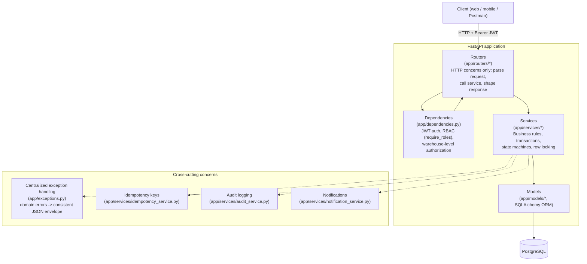

# Architecture Diagram



## Layering rules

1. **Routers** (`app/routers/*.py`) only: parse/validate the HTTP request (via Pydantic schemas), enforce coarse-grained RBAC via `Depends(require_roles(...))`, call exactly one service function, and shape the HTTP response. They never contain business logic.
2. **Dependencies** (`app/dependencies.py`) resolve the authenticated `User` from the JWT, enforce role-based authorization, and enforce warehouse-level authorization (`assert_warehouse_access`) before a router even reaches the service layer.
3. **Services** (`app/services/*.py`) hold all business rules: order state-machine transitions, inventory reservation/release with row-level locking, return workflows, dashboard aggregation, idempotency handling. Services are the transaction boundary — a service function either commits a fully consistent change or raises and lets the caller roll back.
4. **Models** (`app/models/*.py`) are thin SQLAlchemy ORM mappings plus DB-level constraints (`CHECK`, `UNIQUE`, `FOREIGN KEY`) that act as a last line of defense against invalid data, independent of application logic.

## Request flow example: creating an order

```
POST /api/orders
  -> router (orders.py): parses OrderCreate, resolves current_user via JWT
  -> require_roles(CUSTOMER) dependency
  -> order_service.create_order():
       - creates Order + flush() to get order.id
       - for each item:
           - inventory_service.reserve_inventory() takes a row lock
             (SELECT ... FOR UPDATE) on the (product, warehouse) inventory
             row, checks available_quantity, moves stock to "reserved"
           - snapshots unit_price from the product's current price
           - creates OrderItem
       - records OrderStatusHistory (-> PENDING)
       - writes an AuditLog row
       - creates a Notification row
       - commits ONCE, atomically, at the end
  -> if ANY step raises (insufficient inventory, inactive product, etc.)
     the whole transaction rolls back: no partial order, no partial
     reservation is left behind.
```
