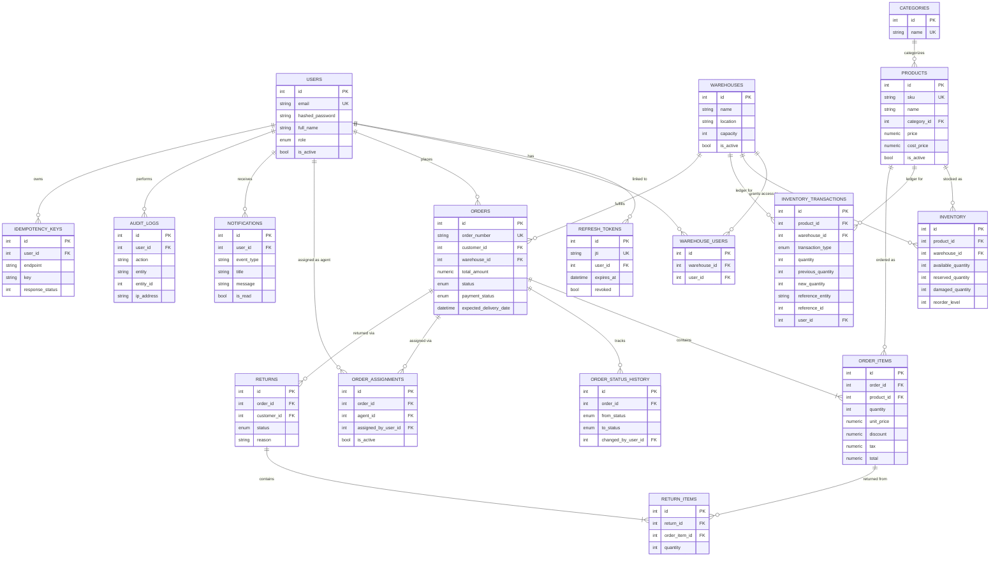

# Entity-Relationship Diagram

Renders natively on GitHub (Mermaid). See `docs/architecture-diagram.md` for the layered request-flow diagram.

## Design notes

- **`inventory`** is one row per `(product_id, warehouse_id)` pair (unique constraint) — this row is the row-level lock target for every reservation/release/adjust/transfer operation. See `app/services/inventory_service.py` for the concurrency strategy in full.
- **`inventory_transactions`** is an append-only ledger: every change to an `inventory` row produces exactly one (or two, for transfers) transaction rows recording `previous_quantity`/`new_quantity`, so the full history of any stock level is always reconstructible and auditable independently of the current `inventory` row.
- **`order_items.unit_price`** is snapshotted at order-creation time from `products.price` and never updated afterwards, even if the product's price changes later — this is enforced simply by never writing to it again after insert.
- **`audit_logs`** and **`inventory_transactions`** are treated as immutable at the application layer: no service function ever updates or deletes rows in these tables.
